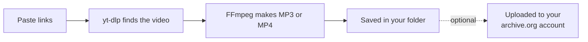

<p align="center">
  
</p>

<p align="center">
  
  
  
  
</p>

<p align="center">
  A small Windows app that saves videos from YouTube and the 1,000+ other sites
  <a href="https://github.com/yt-dlp/yt-dlp">yt-dlp</a> supports, and can upload them to
  your own <a href="https://archive.org">archive.org</a> account with a proper title,
  description, topics and thumbnail. No command line needed.
</p>

<h3 align="center">
  <a href="../../releases/latest">⬇ Download the latest version</a>
</h3>

---

## Contents

- [Features](#features)
- [How it works](#how-it-works)
- [Install](#install)
- [Quick start](#quick-start)
- [Uploading to archive.org](#uploading-to-archiveorg)
- [Handy tools](#handy-tools)
- [Use it responsibly](#use-it-responsibly)
- [Troubleshooting](#troubleshooting)
- [Privacy and where things are stored](#privacy-and-where-things-are-stored)
- [Building from source](#building-from-source)
- [Third-party components](#third-party-components)
- [License](#license)

<!-- Screenshot: upload a picture of the app as docs/screenshot.png, then remove this line and the one below.
<p align="center"></p>
-->

## Features

**Downloading**
- MP3 (music) or MP4 (video) up to 4K. MP4 prefers H.264, so it plays everywhere.
- Several links at once, whole playlists (asks first above 25 videos).
- Any site yt-dlp supports. If a site's own support breaks, it automatically tries
  yt-dlp's generic page scanner.
- yt-dlp keeps itself up to date; choose the stable or nightly channel.

**archive.org**
- Uploads every saved file to your account, one item per video.
- Topics built from the video's tags, hashtags, category and keywords, plus your own.
- Author, Creative Commons license and language fields.
- Thumbnail and subtitles uploaded with the video.
- Big files go up in parts: a Wi-Fi drop only re-sends one part, and a stopped
  upload continues where it left off.
- Waits when archive.org's upload queue is full instead of failing.
- Explains refusals in plain words (keys, someone else's item, hidden item, account limit).

**For tricky sites**
- **Teach a new site:** give it a link to one video and it builds and tests a
  yt-dlp plugin for that site. No programming needed.
- Stream links (`.m3u8` / `.mpd`) for sites nothing else understands.
- Cookies from Firefox or from a `cookies.txt` file, for videos that need you to be signed in.
- One-click helper for YouTube "HTTP Error 403: Forbidden" (PO tokens).

## How it works



Everything runs on your own PC. The app only talks to the video sites you use,
GitHub (for tool updates) and archive.org (only if you upload).

## Install

**You need:** Windows 10 or 11 and an internet connection. Nothing else: the builder
installs Python for you if it's missing.

1. Download **`Build_Video_Archiver.bat`** from the
   [latest release](../../releases/latest).
2. Double-click it. A black window opens and:
   - installs Python 3.13 for your user with `winget` if you don't have Python 3.11+
     (winget may show its terms: type `Y` to accept),
   - downloads yt-dlp, FFmpeg and Deno from their official GitHub releases and
     **checks every download against a known checksum**,
   - builds `Video Archiver.exe`, installs it and adds desktop and Start menu shortcuts.
3. After 5–10 minutes the app opens. You can delete the `.bat` file.

**Update:** download the newest `.bat` and run it again. Your settings are kept.
**Uninstall:** Windows **Settings > Apps**, or **Help > Uninstall** in the app.

> [!NOTE]
> Windows SmartScreen or your antivirus may warn about the `.bat` or the built app.
> The app is built on your own PC with PyInstaller, which some antivirus programs
> distrust in general. You can read every line of the source in this repository.

## Quick start

1. **Step 1:** paste one or more links, one per line.
2. **Step 2:** choose MP3 or MP4 and a quality.
3. **Step 3:** choose the folder to save to.
4. Press **Download** (or <kbd>Ctrl</kbd>+<kbd>Enter</kbd>).

The activity log at the bottom shows what happens. Green means done, yellow is a
note, red is an error with a plain explanation.

## Uploading to archive.org

1. Create a free account at [archive.org](https://archive.org).
2. Open <https://archive.org/account/s3.php> and copy your two keys.
3. In the app, **Step 4 > Account…**: paste both keys and press **Check & Save**.
   They're stored encrypted with Windows (DPAPI), so only your Windows account can read them.
4. Tick **Also upload every saved file to my archive.org account**.

Each video becomes its own item at `archive.org/details/<your-prefix>-<video id>`.

> [!TIP]
> Turn on **Options > archive.org trial mode** for your first uploads. They go to
> archive.org's test collection and are deleted automatically after about 30 days.

## Handy tools

| Where | What it does |
|---|---|
| **Step 4 > Upload files…** | Finds videos you downloaded earlier and uploads the ones missing on archive.org, for example after an upload failed. |
| **Tools > Teach Video Archiver a new site…** | Builds a yt-dlp plugin for a site that isn't supported, from one example link. |
| **Tools > Add a stream link…** | Downloads a video from its `.m3u8`/`.mpd` address (found with F12 > Network). |
| **Tools > Check a site or link…** | Tests whether a link works right now and explains why not. |
| **Tools > Fix YouTube "403 Forbidden"…** | Installs the PO-token helper yt-dlp recommends. |
| **Options > Cookies** | Use your Firefox sign-in or a `cookies.txt` export for sign-in-only videos. |

## Use it responsibly

This tool downloads and re-publishes videos. **You are responsible for what you do with it.**

- Only upload videos you have the right to share: your own, public-domain works, or
  videos under a license that allows it. archive.org removes items after rights
  complaints and closes the accounts of repeat infringers
  ([archive.org's rights policy](https://help.archive.org/help/rights/)).
- Respect the terms of the sites you download from.
- Only choose a Creative Commons license for videos you hold the rights to.
- By default, uploads say where a video came from. A checkbox in Step 4 can leave
  that out; don't use it to pass off other people's work as your own.
- If archive.org has hidden a video's item, the app asks at the end of the run before
  uploading it again under a new name. Don't do that for items removed after a rights complaint.

## Troubleshooting

<details>
<summary><b>"archive.org refused the upload: Access Denied"</b></summary>

The app checks why and says so in the log: your keys stopped working (enter them
again under **Options > archive.org account**), the item belongs to someone else
(change your prefix there), archive.org hid the item, or archive.org is limiting
your account for a while (wait a few hours, upload fewer videos at once).
</details>

<details>
<summary><b>YouTube: "HTTP Error 403: Forbidden" or "Sign in to confirm you're not a bot"</b></summary>

Use **Tools > Update yt-dlp now** first. If it continues, install the helper under
**Tools > Fix YouTube "403 Forbidden"**, or use **Options > Cookies > From Firefox**.
</details>

<details>
<summary><b>"certificate verify failed"</b></summary>

The app retries automatically with Windows' own certificate list. If it still fails,
it's usually antivirus "HTTPS scanning" or a school/work network filter.
</details>

<details>
<summary><b>A site isn't supported</b></summary>

Try **Tools > Check a site or link**, then **Tools > yt-dlp channel > Nightly**, then
**Tools > Teach Video Archiver a new site**. As a last resort, find the stream
address with F12 > Network and use **Tools > Add a stream link**.
</details>

<details>
<summary><b>Uploads are slow</b></summary>

That's usually archive.org's servers. Big files are sent in parts, so you can
stop and continue later with **Upload files…** without losing progress.
</details>

## Privacy and where things are stored

| What | Where |
|---|---|
| The app | `%LOCALAPPDATA%\Programs\Video Archiver` |
| Settings, encrypted keys, built-in tools, upload progress | `%LOCALAPPDATA%\VideoArchiver` |
| yt-dlp plugins (including ones the site wizard makes) | `%APPDATA%\yt-dlp\plugins` |
| Downloads (default) | `Downloads\Video Archiver` |

There's no telemetry and no account other than your own archive.org account.

## Building from source

The app is plain Python with Tkinter. The builder is one `.bat` that carries the
Python source inside it, so people only need to download a single file.

```
src/launcher.bat        finds or installs Python, then runs the build
src/build.py            downloads and verifies the tools, runs PyInstaller, installs
src/video_archiver.py   the app
tools/make_bat.py       assembles Build_Video_Archiver.bat from src/
tests/                  automated tests: python tests/run_all.py
```

After changing a file in `src/`:

```
python tools/make_bat.py
python tests/run_all.py
```

Commit the regenerated `Build_Video_Archiver.bat` together with your change. The
tests also run automatically on GitHub for every change. See [CONTRIBUTING.md](CONTRIBUTING.md).

## Third-party components

The builder downloads these when you run it; they are not stored in this repository.

| Component | License | Used for |
|---|---|---|
| [yt-dlp](https://github.com/yt-dlp/yt-dlp) | Unlicense (the Windows build includes GPLv3+ parts) | downloading |
| [FFmpeg](https://github.com/yt-dlp/FFmpeg-Builds) | GPL | converting, merging, thumbnails |
| [Deno](https://github.com/denoland/deno) | MIT | yt-dlp's YouTube support |
| [bgutil-ytdlp-pot-provider](https://github.com/Brainicism/bgutil-ytdlp-pot-provider) | GPL-3.0 | optional YouTube 403 helper |
| [PyInstaller](https://pyinstaller.org) | GPL with bootloader exception | building the exe |

If you share a **built** `Video Archiver.exe`, the licenses of the bundled tools apply
to that copy (for example, the GPL's obligation to offer the source code). Sharing the
`.bat` builder avoids this, because everyone builds their own copy.

## License

The code in this repository is released under the [MIT License](LICENSE).
Video Archiver is not affiliated with YouTube, the Internet Archive or the yt-dlp project.
